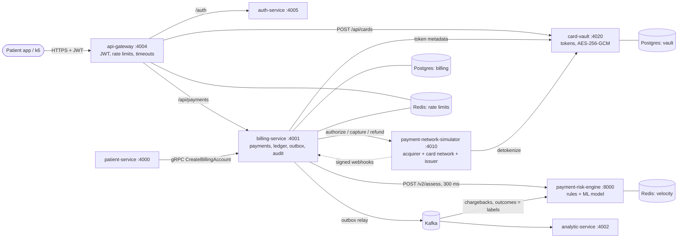
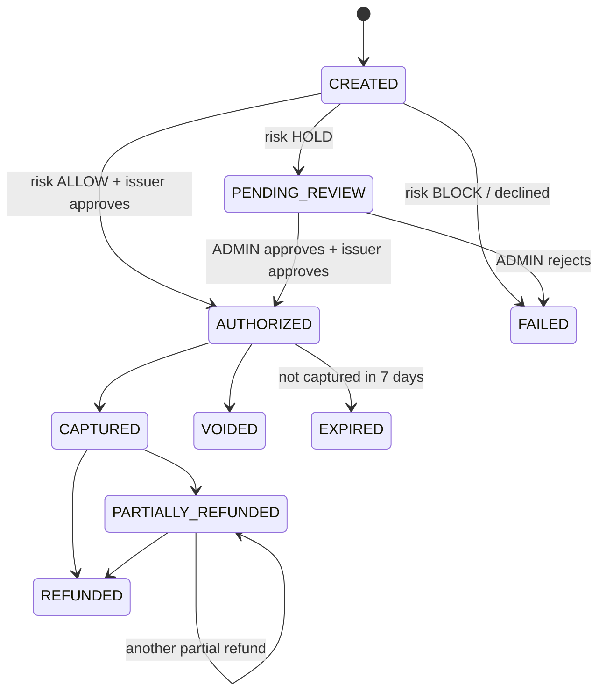
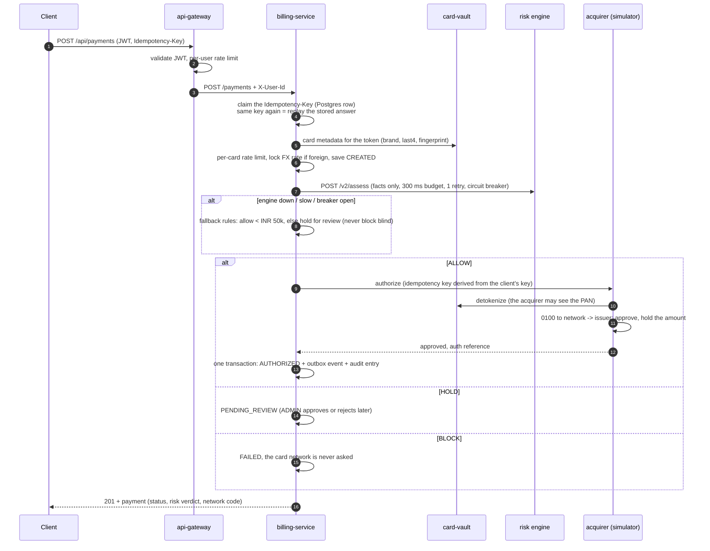
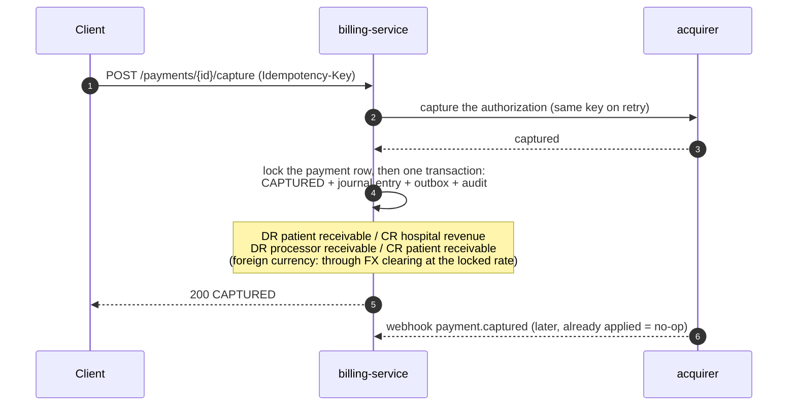
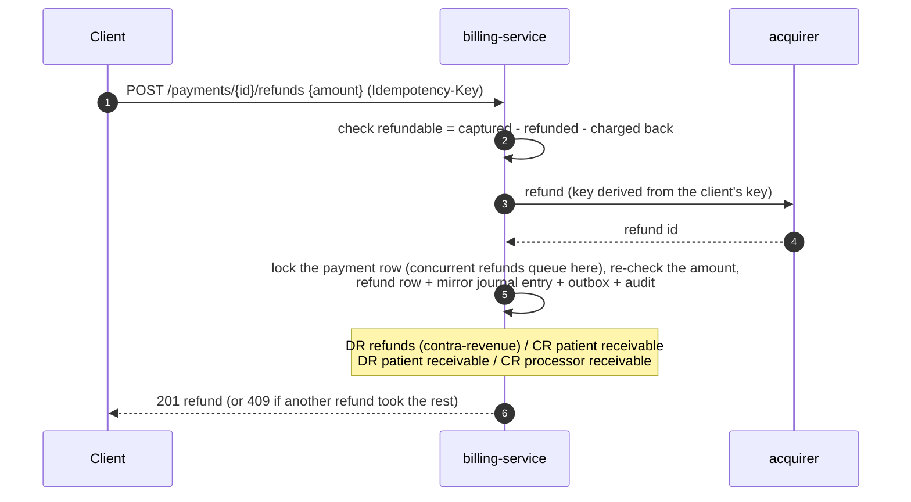
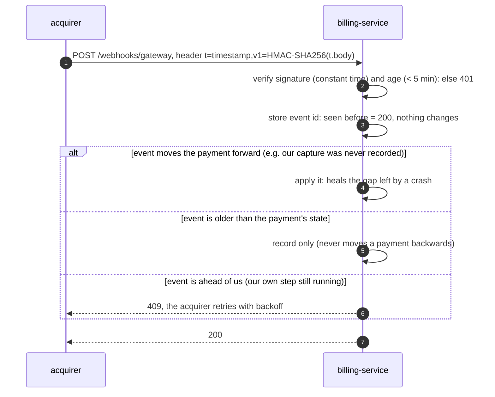
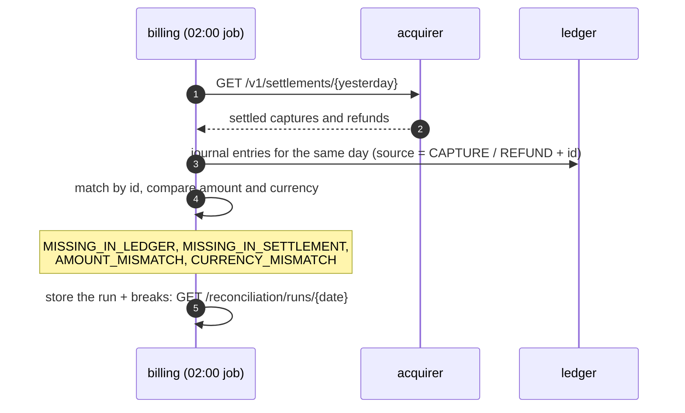

<div align="center">

# Hospital Payments Platform

**Card payments for a hospital, built like a payment company would: a double-entry ledger, idempotent APIs, a
card vault, an ISO 8583-style card network simulator, a real-time risk check, reconciliation, and an audit trail —
load-tested and chaos-tested, with every number measured.**

[](https://github.com/amitsaini1912/patient-management-microservices/actions/workflows/ci.yml)


</div>

The risk engine lives in its own repo: [payment-risk-engine](https://github.com/amitsaini1912/payment-risk-engine)
(Python, FastAPI, scikit-learn).

## The problem

A patient pays a hospital bill by card. Getting that right is harder than calling a payment API:

- **Money must never be created, lost or moved twice**, even when the client retries, two requests race, the
  acquirer times out, or the process dies between "the bank approved it" and "we wrote it down".
- **Every rupee must be explainable**: which account it sits in, why it moved, and whether our books agree with the
  acquirer's settlement report.
- **Card numbers must not spread**: one service may see them, the rest only see tokens.
- **Fraud must be stopped before the card is charged**, without letting a slow fraud check take payments down.

## What it does — and the evidence

| Guarantee | How | Evidence |
|---|---|---|
| Money is never double-moved | `Idempotency-Key` on every money-moving POST; deterministic acquirer keys; row lock when recording | 120 concurrent refunds on one payment, retry storms: acquirer called once per step (`CorrectnessIntegrationTest`, ADR 0021) |
| Books always balance | double-entry ledger, append-only, enforced by Postgres constraints + triggers | every entry and the whole ledger sum to 0 per currency, checked after storms and chaos |
| Our records match the acquirer's | daily reconciliation against the settlement report | ADR 0011, `ReconciliationIntegrationTest` |
| No event lost, none duplicated | transactional outbox → Kafka; consumers deduplicate | Kafka down 60 s under load: 936 events held, sent within 5 s of recovery ([CHAOS](docs/CHAOS.md)) |
| Card numbers stay in one place | card-vault (AES-256-GCM, key versions, HMAC fingerprints); billing sees tokens only | PCI log-masking tests; 0 card numbers in any log (Day 20b) |
| Fraud checked before the network | risk engine within a 300 ms budget, retry, circuit breaker, safe fallback rules | engine paused under load: 0 errors, breaker opened and closed by itself ([CHAOS](docs/CHAOS.md)) |
| History can't be rewritten | HMAC hash-chained audit log, appended in the same transaction | `GET /audit/verify`; tampering tests (ADR 0016) |
| Tells clients the truth when something breaks | 503 + Retry-After for temporary failures, 504 on timeouts; never 500 for an outage | Toxiproxy + live chaos ([CHAOS](docs/CHAOS.md), ADR 0023) |

Measured on one laptop (Intel i5-13500H), whole path through the gateway ([PERFORMANCE](docs/PERFORMANCE.md)):
**8,324 checkouts, 0 errors, p95 93 ms**; every payment risk-checked up to **30 checkouts/s** (one risk-engine
worker), after finding and fixing the bottleneck (15 → 30/s).

## Architecture



| Service | What it owns | Port |
|---|---|---|
| **billing-service** | payments (state machine), refunds, chargebacks, double-entry ledger, FX, idempotency, outbox, audit log, reconciliation | 4001 (HTTP), 9001 (gRPC) |
| **card-vault** | card numbers (encrypted), tokens, fingerprints; the only place a PAN is stored | 4020 |
| **payment-network-simulator** | our acquirer: ISO 8583-style 0100/0400 to a card network and an issuer with balances and holds; settlement reports; signed webhooks | 4010 |
| **api-gateway** | JWT validation (via auth-service), per-user rate limits, identity headers, timeouts | 4004 |
| **auth-service** | login, JWT | 4005 |
| **patient-service** | patients; creates the billing account over gRPC | 4000 |
| **analytic-service** | consumes payment events (idempotent consumer, dead-letter topics) | 4002 |
| [payment-risk-engine](https://github.com/amitsaini1912/payment-risk-engine) | `/v2/assess`: velocity (Redis), rules with reason codes, ML score; learns from chargebacks | 8000 |

### Payment states



## How the main flows work

### Authorize, with the risk check



If the acquirer doesn't answer, the outcome is unknown: the client gets **503 + Retry-After** and retries with the
same key, which reaches the acquirer with the same key and gets the original result (ADR 0023). If nobody retries,
a job asks the acquirer about payments still CREATED after 15 minutes and settles them: FAILED if it never received or
declined the authorization, voided if it authorized one nobody was told about (ADR 0024).

### Capture (and what the ledger records)



### Refund



### Webhooks from the acquirer



### Daily reconciliation



## Run it

Needs JDK 21, Docker, Python 3, and (for load tests) [k6](https://k6.io).

```bash
# build the jars once
for s in api-gateway auth-service billing-service card-vault payment-network-simulator; do
  (cd $s && sh ./mvnw -q -DskipTests package); done

# the risk engine repo next to this one (compose builds it from ../payment-risk-engine)
git clone https://github.com/amitsaini1912/payment-risk-engine ../payment-risk-engine

sh load-test/start-stack.sh      # compose (Postgres x2, Kafka, Redis, risk engine, Prometheus, Grafana)
                                 # + the 5 Java services; generated secrets, own compose project
sh load-test/demo.sh             # one payment end to end, step by step
sh load-test/stop-stack.sh --wipe
```

`demo.sh` logs in, creates a billing account over gRPC, tokenizes a card, authorizes (risk check + card network),
shows that a retry with the same key replays, captures, refunds part of it, reads the payment back, and verifies the
audit chain. Then: Grafana at http://localhost:3000 (dashboard "Payments overview"), Prometheus at :9090.

Development without the scripts: `cp .env.example .env`, `docker compose up -d billing-db vault-db kafka redis`, run a
service with `sh ./mvnw spring-boot:run`. Tracing: `docker compose up -d jaeger` and `monitoring/otel/run-traced.sh`.

### Tests

```bash
cd billing-service && sh ./mvnw verify          # 427 tests, Testcontainers (Postgres, Kafka, Redis, Toxiproxy)
# with a coverage report (target/site/jacoco/index.html), the command CI runs:
sh ./mvnw org.jacoco:jacoco-maven-plugin:0.8.12:prepare-agent verify org.jacoco:jacoco-maven-plugin:0.8.12:report
```

Load and chaos (stack running): `k6 run -e PROFILE=step load-test/checkout.js`, `sh load-test/chaos.sh kafka`
(also `risk`, `db`, `redis`, `vault`, `simulator`).

Measured 2026-11-01 with the CI command (JaCoCo; "hand-written" leaves out the protobuf/gRPC classes generated at
build time, which the all-classes figure includes):

| Service | Tests | Lines (hand-written) | Branches | Lines, all classes |
|---|---|---|---|---|
| billing-service | 407 | **92.4%** | 79.6% | 66.7% |
| payment-network-simulator | 35 | 92.7% | 79.1% | 92.7% |
| card-vault | 43 | 92.2% | 81.2% | 92.2% |
| api-gateway | 12 | 93.9% | 76.5% | 93.9% |
| analytic-service | 7 | 69.6% | 70.6% | 37.2% |
| auth-service | 3 | 59.6% | 66.7% | 59.6% |
| patient-service | 6 | 51.6% | 0% | 8.0% |
| [payment-risk-engine](https://github.com/amitsaini1912/payment-risk-engine) | 253 | 92% (pytest-cov) | | |

auth, patient and analytics predate the payments work and were only lightly extended; the payment path is where
the tests are.

CI runs every service's tests on each push, in parallel, with coverage in the job summary (report only).

## Documents

- [docs/adr/](docs/adr/) — 31 architecture decisions: what was chosen, the alternatives, and the cost
- [docs/PERFORMANCE.md](docs/PERFORMANCE.md) — k6 load test, the bottleneck, before/after
- [docs/CHAOS.md](docs/CHAOS.md) — six failures under load, what happened, what was fixed
- [docs/ROUNDING.md](docs/ROUNDING.md) — money in minor units, rounding and allocation rules

## Known limitations (honest list)

- **Abandoned authorizations wait for the 7-day expiry.** Payments left CREATED by an acquirer outage are settled
  after 15 minutes (ADR 0024), but a payment billing recorded as AUTHORIZED whose client then gave up (59 in a 60 s
  freeze) looks like any uncaptured authorization and is released only by the expiry job.
- The risk engine ran **one worker** in the checkout load test: ~30 risk-checked payments/s on this laptop; above that
  billing degrades to its fallback rules (safely, but without the model). It now runs 4 workers (engine alone: 80
  checks/s at p99 140 ms, its ADR 0011); re-run of the checkout test: 100% risk-checked up to 40/s (PERFORMANCE.md).
- Login: per-IP limit + account lockout (ADR 0027). A lockout can be triggered by someone else (5 wrong passwords),
  and behind NAT / a load balancer the per-IP limit needs `gateway.trusted-proxies` or all clients share one bucket.
- Payouts are not modelled (the acquirer's receivable never moves to a bank account); FX rates are entered by hand.
- The simulator keeps state in memory; card-vault keys come from env (production: KMS/HSM envelope encryption).
- Roles are just USER / ADMIN (reviews, chargebacks, reconciliation, FX writes are ADMIN only - ADR 0031), and they
  are trusted only because billing is reachable through the gateway alone.
- Kubernetes manifests in `k8s/` predate the payments work and don't include card-vault, the simulator or the risk
  engine. Docker Compose + scripts are the supported way to run it.

## Project structure

```
billing-service/            payments, ledger, refunds, chargebacks, FX, idempotency, outbox, audit, reconciliation
card-vault/                 tokenization (the only place card numbers are stored)
payment-network-simulator/  acquirer + card network + issuer, settlement reports, signed webhooks
api-gateway/  auth-service/  patient-service/  analytic-service/
load-test/                  start/stop the stack, demo, k6 checkout test, chaos runner, results/
monitoring/                 Prometheus, Grafana dashboard (provisioned), OpenTelemetry agent scripts
docs/                       ADRs, PERFORMANCE.md, CHAOS.md, ROUNDING.md
k8s/  infrastructure/       older deployment experiments (see limitations)
```
